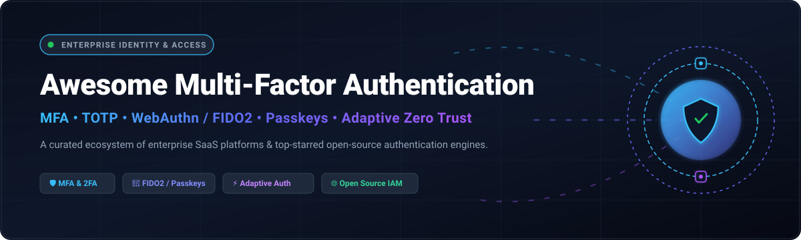

<p align="center">
  
</p>

# 🔐 Awesome Multi-Factor Authentication (MFA)

<p align="center">
  <a href="https://github.com/ishandutta2007/Awesome-Awesome-Awesome"></a>
  <a href="https://discord.gg/jc4xtF58Ve"></a>
  <a href="https://github.com/ishandutta2007/Awesome-Multi-Factor-Authentication-MFA/stargazers"></a>
  <a href="https://github.com/ishandutta2007/Awesome-Multi-Factor-Authentication-MFA/network/members"></a>
  <a href="https://github.com/ishandutta2007/Awesome-Multi-Factor-Authentication-MFA/blob/main/LICENSE"></a>
  <a href="https://github.com/ishandutta2007"></a>
</p>

---

## 📌 Overview & Ecosystem Summary

> **Comprehensive, curated guide to leading Multi-Factor Authentication (MFA) SaaS platforms, passwordless tools, and open-source identity verification frameworks.**

Multi-Factor Authentication (MFA) and Two-Factor Authentication (2FA) provide layered identity defense by requiring two or more distinct credentials before granting system access: something you know (passwords, PINs), something you have (FIDO2 security keys, TOTP tokens, smartphones), and something you are (biometrics). As zero-trust architectures, NIST 800-63B standards, and cyber insurance mandates accelerate worldwide, modern MFA has evolved from legacy SMS codes to phishing-resistant WebAuthn passkeys, device telemetry checks, and risk-based adaptive step-up authentication.

---

## 📊 Sector Overview & Market Dynamics

The global Multi-Factor Authentication (MFA) market was valued at approximately **$15.2 billion in 2024** and is projected to surpass **$38.4 billion by 2030**, advancing at a compound annual growth rate (CAGR) of **16.8%**. The sector is **moderately fragmented**: mega-cap hyper-scalers (Microsoft, Cisco, Salesforce) and specialized IAM leaders (Okta, Ping Identity) dominate enterprise single sign-on deployments, while a vibrant ecosystem of specialized hardware vendors (Yubico) and high-velocity open-source identity providers (Keycloak, Authentik, Zitadel, Ory) capture significant developer-led and sovereign infrastructure market share.

---

## 📑 Table of Contents

- [📊 Sector Overview & Market Dynamics](#-sector-overview--market-dynamics)
- [🏢 SaaS & Hosted Enterprise MFA Platforms](#-saas--hosted-enterprise-mfa-platforms)
- [💻 Top Open-Source MFA & Identity Projects](#-top-open-source-mfa--identity-projects)
- [🛠️ Developer Libraries & Building Blocks](#️-developer-libraries--building-blocks)
- [🏗️ Reference Self-Hosted MFA Architecture](#️-reference-self-hosted-mfa-architecture)
- [🤝 How to Contribute](#-how-to-contribute)
- [⚖️ Disclaimer](#️-disclaimer)

---

## 🏢 SaaS & Hosted Enterprise MFA Platforms

The following table benchmarks category-defining SaaS and commercial MFA providers, ranked by company scale (market capitalization / corporate valuation in descending order).

| 🏢 Platform | 💰 Company Valuation / Revenue Scale | 💵 Starting Tier Pricing | 🎁 Free Tier Limit / Free Trial | 🛡️ Key MFA Authentication Capabilities |
| :--- | :--- | :--- | :--- | :--- |
| **[Microsoft Entra ID MFA](https://www.microsoft.com/en-us/security/business/identity-access/microsoft-entra-id)** | **$3.15T+ Market Cap** ($245B+ ARR) | $6.00/user/month (Entra ID P1) | Free forever for basic MFA with Microsoft Authenticator (or 30-day trial of P1/P2) | FIDO2 security keys, Authenticator number-matching push, SMS, Voice, conditional access, risk-based step-up |
| **[Google Authenticator / Workspace](https://security.googleblog.com/)** | **$2.05T+ Market Cap** ($350B+ ARR) | $6.00/user/month (Google Workspace Business Starter) | Authenticator mobile app 100% free forever; Workspace has a 14-day free trial | Passkeys, TOTP/HOTP codes, Titan Security Key FIDO2 support, prompt-based push notifications |
| **[Salesforce Authenticator](https://www.salesforce.com/)** | **$265B+ Market Cap** ($38B+ ARR) | $25.00/user/month (Starter Suite) | Authenticator mobile app free forever for all Salesforce accounts; 30-day free trial for CRM | Push notifications with GPS geolocation verification, TOTP backup generation, automated trusted locations |
| **[Cisco Duo](https://duo.com/)** | **$215B+ Market Cap** ($57B+ ARR) | $3.00/user/month (Duo Essentials) | Free forever tier for up to 10 users with Duo Push and TOTP (or 30-day trial for up to 50 users) | Duo Push with number matching, WebAuthn passkeys, hardware tokens, risk-based device health verification |
| **[Authy (Twilio)](https://authy.com/)** | **$11.8B+ Market Cap** ($4.3B+ ARR) | $0.05/active user/month (Twilio Verify SDK) | Authy consumer authenticator app is 100% free forever; Twilio Verify includes $15 free trial credit | Multi-device encrypted cloud backup, TOTP generation, SMS OTP API, push-based biometric approval |
| **[Okta Verify](https://www.okta.com/)** | **$11.2B+ Market Cap** ($2.6B+ ARR) | $2.00/user/month (Okta Adaptive MFA) | 30-day full-featured free trial with up to 5,000 active users | FastPass passwordless biometric verify, push notification with number challenge, WebAuthn, FIDO2, risk engines |
| **[Yubico](https://www.yubico.com/)** | **$2.4B+ Market Cap** ($205M+ ARR) | $50.00/hardware key (YubiKey 5 Series one-time) | Yubico Authenticator companion software is 100% free forever (requires physical hardware key) | Hardware-backed FIDO2/WebAuthn, U2F, Smart Card (PIV), TOTP/HOTP, OpenPGP, zero-phishing physical tokens |
| **[Ping Identity](https://www.pingidentity.com/)** | **$2.8B Acquisition Valuation** ($350M+ ARR) | $3.00/user/month (PingID Essential) | 30-day free trial with unlimited users and complete feature set | PingID mobile push, QR code scan, FIDO2 biometric authentication, swipe approvals, adaptive risk policies |
| **[RSA SecurID](https://www.rsa.com/en-us/products/rsa-securid-suite)** | **$2.08B Valuation** ($310M+ ARR) | $2.00/user/month (SecurID Access Cloud) | 45-day free enterprise evaluation trial with up to 25 users | Hardware token fobs, software token apps, push to approve, risk-based behavioral context analytics |
| **[OneLogin Protect](https://www.onelogin.com/)** | **$500M+ Acquisition Valuation** ($110M+ ARR) | $4.00/user/month (OneLogin Advanced MFA) | 30-day free trial with full access for up to 50 users | Push notification approvals with biometric fingerprint/FaceID, TOTP generation, pairing via QR code |

---

## 💻 Top Open-Source MFA & Identity Projects

Open-source authentication servers, self-hosted IAM platforms, and client-side authenticator apps, **sorted by GitHub stargazers count (descending)**.

| 💻 Repository | ⭐ GitHub Stars | 📜 License | 🔍 Primary Architecture & MFA Highlights |
| :--- | :--- | :--- | :--- |
| **[Keycloak](https://github.com/keycloak/keycloak)** | [](https://github.com/keycloak/keycloak/stargazers) | `Apache-2.0` | Enterprise IAM and SSO server with full support for TOTP, WebAuthn/FIDO2 hardware keys, and backup recovery codes. |
| **[Authelia](https://github.com/authelia/authelia)** | [](https://github.com/authelia/authelia/stargazers) | `Apache-2.0` | Lightweight authentication and multi-factor authorization companion for reverse proxies (Nginx, Traefik, Caddy) featuring TOTP, WebAuthn, and Duo push. |
| **[Authentik](https://github.com/goauthentik/authentik)** | [](https://github.com/goauthentik/authentik/stargazers) | `GPL-3.0` | Flexible open-source Identity Provider (IdP) supporting TOTP stages, WebAuthn authenticator devices, Duo push, and SMS tokens. |
| **[Bitwarden Server](https://github.com/bitwarden/server)** | [](https://github.com/bitwarden/server/stargazers) | `GPL-3.0` | Backend vault and identity service powering end-to-end encrypted storage, integrated TOTP authenticator generation, and FIDO2 MFA logins. |
| **[SuperTokens](https://github.com/supertokens/supertokens-core)** | [](https://github.com/supertokens/supertokens-core/stargazers) | `Apache-2.0` | Modular developer-first authentication solution with native MFA recipes including TOTP generation and SMS/Email OTP step-up verification. |
| **[Zitadel](https://github.com/zitadel/zitadel)** | [](https://github.com/zitadel/zitadel/stargazers) | `Apache-2.0` | Cloud-native multi-tenant identity infrastructure written in Go with turnkey passwordless passkeys, WebAuthn, and TOTP. |
| **[Ory Kratos](https://github.com/ory/kratos)** | [](https://github.com/ory/kratos/stargazers) | `Apache-2.0` | Headless, cloud-native identity management system implementing WebAuthn, passkeys, TOTP, and two-factor recovery codes. |
| **[Aegis Authenticator](https://github.com/beemdevelopment/Aegis)** | [](https://github.com/beemdevelopment/Aegis/stargazers) | `GPL-3.0` | Open-source Android authenticator application supporting TOTP/HOTP with AES-256 encrypted vaults and biometric unlock. |
| **[Open Policy Agent (OPA)](https://github.com/open-policy-agent/opa)** | [](https://github.com/open-policy-agent/opa/stargazers) | `Apache-2.0` | General-purpose policy engine enabling contextual, risk-based adaptive MFA evaluation and conditional step-up rules. |
| **[Hanko](https://github.com/teamhanko/hanko)** | [](https://github.com/teamhanko/hanko/stargazers) | `AGPL-3.0` | Lightweight passwordless authentication service built around FIDO2 passkeys, WebAuthn, and TOTP verification workflows. |
| **[Step CA (Smallstep)](https://github.com/smallstep/certificates)** | [](https://github.com/smallstep/certificates/stargazers) | `Apache-2.0` | Private X.509 and SSH certificate authority featuring automated issuance paired with OIDC/MFA identity verification. |
| **[SpiceDB](https://github.com/authzed/spicedb)** | [](https://github.com/authzed/spicedb/stargazers) | `Apache-2.0` | High-performance authorization database inspired by Google Zanzibar to guard privileged operations with MFA assertions. |
| **[OpenFGA](https://github.com/openfga/openfga)** | [](https://github.com/openfga/openfga/stargazers) | `Apache-2.0` | Relationship-based access control engine providing fine-grained permission enforcement requiring multi-factor challenges. |
| **[Cerbos](https://github.com/cerbos/cerbos)** | [](https://github.com/cerbos/cerbos/stargazers) | `Apache-2.0` | Decoupled authorization layer for evaluating contextual user attributes, session age, and MFA verification levels. |
| **[andOTP](https://github.com/andOTP/andOTP)** | [](https://github.com/andOTP/andOTP/stargazers) | `MIT` | Open-source Android two-factor authentication app supporting TOTP/HOTP with encrypted backup exports. |
| **[Ory Oathkeeper](https://github.com/ory/oathkeeper)** | [](https://github.com/ory/oathkeeper/stargazers) | `Apache-2.0` | Zero-trust Identity and Access Proxy (IAP) that validates incoming HTTP requests against MFA session cookies and tokens. |
| **[pquerna/otp](https://github.com/pquerna/otp)** | [](https://github.com/pquerna/otp/stargazers) | `Apache-2.0` | High-performance Golang library implementing RFC 6238 TOTP and RFC 4226 HOTP with QR-code generation and validation. |
| **[Speakeasy](https://github.com/speakeasyjs/speakeasy)** | [](https://github.com/speakeasyjs/speakeasy/stargazers) | `MIT` | Ubiquitous Node.js two-factor authentication library implementing one-time passcode verification for JavaScript backends. |
| **[PrivacyIDEA](https://github.com/privacyidea/privacyidea)** | [](https://github.com/privacyidea/privacyidea/stargazers) | `AGPL-3.0` | Modular enterprise multi-factor authentication backend supporting TOTP, HOTP, FIDO2/WebAuthn, YubiKey, and SMS/push. |
| **[FreeOTP Android](https://github.com/freeotp/freeotp-android)** | [](https://github.com/freeotp/freeotp-android/stargazers) | `Apache-2.0` | Red Hat-backed open-source 2FA authenticator app for Android adhering to strict open token standards. |
| **[2FAS Android](https://github.com/twofas/2fas-android)** | [](https://github.com/twofas/2fas-android/stargazers) | `GPL-3.0` | Android client for 2FAS featuring cloud-free encrypted backup, browser extension pairing, and biometric locking. |
| **[Yubico Authenticator Flutter](https://github.com/Yubico/yubioath-flutter)** | [](https://github.com/Yubico/yubioath-flutter/stargazers) | `Apache-2.0` | Cross-platform desktop and mobile application generating TOTP credentials stored directly on physical YubiKey hardware. |
| **[py_webauthn](https://github.com/duo-labs/py_webauthn)** | [](https://github.com/duo-labs/py_webauthn/stargazers) | `BSD-3-Clause` | Pythonic server-side implementation of the WebAuthn standard for passwordless login and multi-factor hardware security keys. |
| **[Raivo OTP](https://github.com/raivo-otp/ios-application)** | [](https://github.com/raivo-otp/ios-application/stargazers) | `MIT` | Native iOS two-factor authentication client with encrypted backup, search, and FaceID/TouchID unlocking. |
| **[WSO2 Identity Server](https://github.com/wso2/product-is)** | [](https://github.com/wso2/product-is/stargazers) | `Apache-2.0` | Enterprise-grade API-driven IAM server supporting adaptive authentication, FIDO2/WebAuthn, email/SMS OTP, and TOTP. |
| **[FreeOTP iOS](https://github.com/freeotp/freeotp-ios)** | [](https://github.com/freeotp/freeotp-ios/stargazers) | `Apache-2.0` | Red Hat-maintained native iOS client generating time-based and event-based one-time passwords via QR code scanning. |
| **[2FAS iOS](https://github.com/twofas/2fas-ios)** | [](https://github.com/twofas/2fas-ios/stargazers) | `GPL-3.0` | Native Swift iOS authenticator client featuring iCloud sync, biometric protection, and one-tap approval notifications. |
| **[OTPClient](https://github.com/paolostivanin/OTPClient)** | [](https://github.com/paolostivanin/OTPClient/stargazers) | `GPL-3.0` | Highly secure GTK4/libadwaita Linux desktop authenticator client supporting encrypted TOTP and HOTP databases. |
| **[LinOTP](https://github.com/LinOTP/LinOTP)** | [](https://github.com/LinOTP/LinOTP/stargazers) | `AGPL-3.0` | Mature enterprise OTP authentication server with support for hardware tokens, smart cards, SMS, and push notification tokens. |
| **[oxAuth (Gluu)](https://github.com/GluuFederation/oxAuth)** | [](https://github.com/GluuFederation/oxAuth/stargazers) | `Apache-2.0` | OpenID Connect and UMA authorization engine powering Gluu Server with built-in FIDO2/WebAuthn and CASA multi-factor module. |
| **[Bitwarden Passwordless.dev](https://github.com/bitwarden/passwordless-server)** | [](https://github.com/bitwarden/passwordless-server/stargazers) | `AGPL-3.0` | Open-source API and backend orchestrator enabling turnkey passkeys and WebAuthn MFA integration in minutes. |
| **[FusionAuth Issues](https://github.com/FusionAuth/fusionauth-issues)** | [](https://github.com/FusionAuth/fusionauth-issues/stargazers) | `Apache-2.0` | Community issue hub and feature tracker for FusionAuth, a self-hostable authentication platform supporting TOTP, SMS, and WebAuthn MFA. |

---

## 🛠️ Developer Libraries & Building Blocks

For developers embedding MFA directly into application backends without external IdPs:

- **🔑 WebAuthn & Passkeys:**
  - `SimpleWebAuthn` (TypeScript/Node.js) — The standard library for WebAuthn passkey registration and verification.
  - `py_webauthn` (Python) — Duo Security's audited library for server-side WebAuthn validation.
  - `webauthn4j` (Java) — Comprehensive FIDO2/WebAuthn implementation for Spring and Java ecosystems.
  - `fido2-net-lib` (.NET / C#) — FIDO2 and WebAuthn multi-factor authenticator library.
- **⏱️ Time-Based One-Time Password (TOTP) Engines:**
  - `otplib` (Node.js) — Battle-tested TOTP and HOTP implementation with customizable crypto plugins.
  - `pyotp` (Python) — Python library for generating and verifying one-time passwords defined in RFC 6238.
  - `pquerna/otp` (Go) — RFC 6238 and RFC 4226 compliant Go package with QR image generation.
  - `rotp` (Ruby) — Fast Ruby implementation of HOTP and TOTP algorithms.
- **🛡️ Adaptive Risk & Step-Up Engines:**
  - `Open Policy Agent (OPA)` — Rego policy evaluation for risk-based challenge escalation.
  - `Cerbos` — Context-aware permission checks enforcing 2FA verification freshness.

---

## 🏗️ Reference Self-Hosted MFA Architecture

```
                       [ Incoming User Traffic ]
                                   │
                                   ▼
                  ┌───────────────────────────────────┐
                  │   Reverse Proxy / API Gateway     │
                  │   (Traefik / Nginx / Caddy)      │
                  └─────────────────┬─────────────────┘
                                    │ Forward Auth
                                    ▼
                  ┌───────────────────────────────────┐
                  │   Authelia / Ory Oathkeeper       │
                  │   (Forward-Auth & Zero-Trust IAP) │
                  └─────────┬───────────────┬─────────┘
                            │               │
            1st Factor Pass │               │ 2nd Factor Challenge
                            ▼               ▼
                  ┌─────────────────┐ ┌─────────────────────────────────┐
                  │  Identity Store │ │   MFA Verification Layer        │
                  │  (LDAP / AD /   │ │   - WebAuthn / Passkeys (FIDO2) │
                  │   Keycloak DB)  │ │   - TOTP App (Aegis / 2FAS)     │
                  │                 │ │   - PrivacyIDEA / LinOTP Server │
                  └─────────────────┘ └─────────────────────────────────┘
```

---

## 🤝 How to Contribute

1. 🍴 **Fork the repository** on GitHub.
2. 🌿 **Create a new branch** (`git checkout -b feature/add-mfa-project`).
3. 📝 **Add your entry** in markdown matching the alphabetical or ranking structure.
4. 🔗 **Include live URLs**, exact license types, and descriptive, non-marketing summaries.
5. 🚀 **Submit a Pull Request** with a concise description of your additions.

---

## ⚖️ Disclaimer

- This repository is a **community-curated index** and does not constitute commercial endorsement or security audit certification.
- All product names, logos, and brands are property of their respective owners.
- Implementers must review local data privacy compliance (GDPR, CCPA, HIPAA) and cryptographic standards (NIST SP 800-63B, FIDO Alliance) before deploying authentication systems in production.

---

<p align="center">
  <sub>Maintained with 🛡️ for security engineers, zero-trust architects, and open-source developers worldwide.</sub>
</p>
